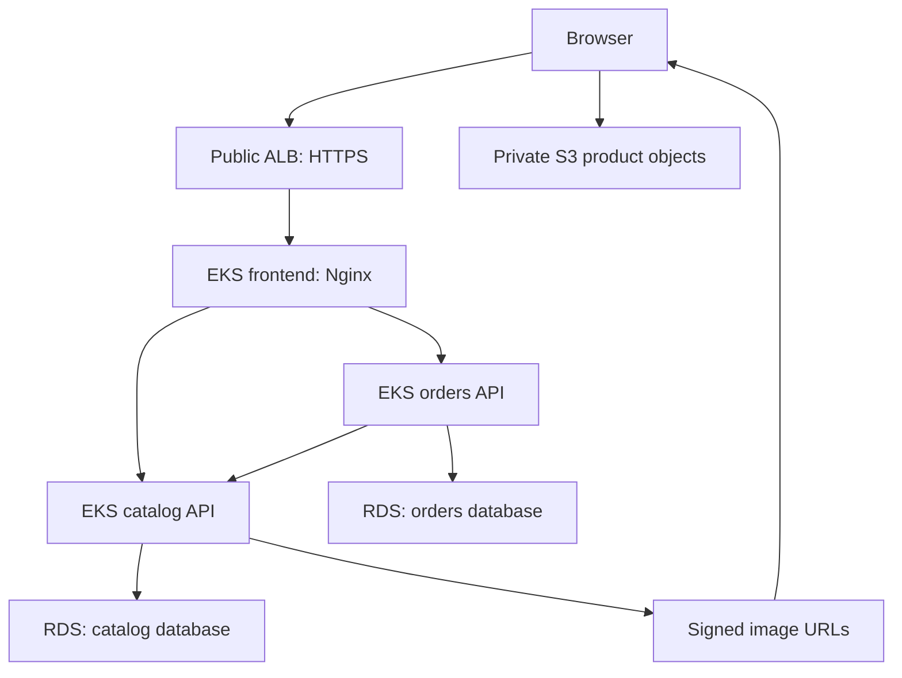

# EKS Store: deployment and portfolio blueprint

Prepared for Krishna• 19 November 2026

## 1. Goal and current status

Build a repeatable AWS DevOps portfolio project: a merge to main tests the application, builds three container images, publishes them to ECR, provisions or updates AWS infrastructure with Terraform, executes database migrations, deploys with Helm, and verifies a real customer order. Store catalog and order records in RDS PostgreSQL; store product pictures and dataset artifacts in private S3. Keep Docker Compose as the local development environment.

This document is an implementation plan grounded in the supplied EKS-Store(2).zip. It does not supply implemented Terraform, Helm charts, or workflow files, and no AWS deployment was performed. Local Docker operation was reported by the owner. The review environment lacked pytest, so the existing tests were not executed here. Production readiness must be established through the acceptance gates below, rather than the existing README's production-ready description.

The first release should be described as a **production-style portfolio deployment**. A continuously available production service additionally needs proven availability, security, recovery, and operational ownership. Future Argo CD, monitoring, and logging work remains explicitly separate.

## 2. Repository assessment and required corrections

| Finding from source | Consequence | Required change |
|---|---|---|
| Three services: Nginx frontend, FastAPI catalog, FastAPI orders | Good fit for three stateless Kubernetes Deployments | Preserve this service boundary; no database pod on EKS |
| Catalog and orders already use PostgreSQL/SQLAlchemy | RDS PostgreSQL is the direct migration target | Retain PostgreSQL; no engine rewrite needed |
| Alembic directories exist for both services | Schema changes can be reproducible | Run each service's migration as a controlled Job before rollout |
| No Terraform, Helm, or GitHub Actions files in the extracted source | The AWS delivery layer is still to be built | Add infrastructure stacks, a chart, and workflows |
| index.html loads catalog_data.js and app.bundle.js | app.bundle.js is the active application, rather than app.js alone | Establish one source/build path; test the exact bundle loaded by the browser |
| app.bundle.js falls back to EMBEDDED_CATALOG on API errors | A healthy-looking page does not prove RDS integration | Disable fallback in AWS mode; show an unavailable state and disable checkout |
| Frontend proxies /api/orders/ but API creates orders at /api/orders | Exact path can redirect rather than reach the intended upstream | Add an exact /api/orders proxy location and test POST without following redirects |
| Browser health calls use /health/live; Nginx defines /healthz and a catch-all SPA route | HTML with status 200 can be mistaken for healthy APIs | Add explicit service health routes or an aggregate health endpoint; validate JSON content |
| scripts/import_catalog.py prints db_url | RDS credentials could enter Job/CI logs | Remove the connection-string log; scrub exception output as well |
| Importer calls Base.metadata.create_all | Import can bypass Alembic migration ownership | Remove this from the AWS path; migrations must own schema creation |
| Importer relies on scripts/data/config mounted by Compose | Catalog runtime image cannot run this seed command unchanged | Build a separate seed image from repository-root context, packaging script, data, mappings, and catalog code |
| S3 image resolver exists using IMAGE_MODE=s3 | Private S3 images are feasible with small changes | Configure bucket/region and grant catalog scoped GetObject via workload identity |
| S3 presigning does not check object existence | A generated URL is not evidence that an image exists | Validate keys with HeadObject during publishing/smoke checks and verify browser retrieval |
| Local placeholder fallback depends on catalog-mounted assets | An AWS fallback path can return 404 | Keep a guaranteed frontend placeholder; prefer a monitored asset failure over silent substitution |
| DB pools default to 10 connections plus 20 overflow per process | Replicas can overwhelm a small RDS instance | Start with conservative pools and calculate total process/replica connection budget |
| Wildcard CORS with credentials enabled | Unnecessary and inappropriate for the same-origin deployment | Use same-origin proxying and remove broad CORS, or explicitly allow the configured UI origin |
| Requirements use lower bounds and container bases use mutable tags | Builds are not fully reproducible | Lock dependencies, pin tested base digests, and record updates through PRs |
| Archive includes .venv and Python caches | Unnecessary bulk and portability problems | Exclude environments/caches from Git and release ZIPs; inspect actual tracked files before publishing |
| Existing full-system test uses in-memory SQLite and mocked downstream calls | Useful application tests, but not proof of PostgreSQL/network behavior | Add real PostgreSQL and deployed HTTP integration tests |

Before publishing the repository, scan tracked content and Git history for credentials and rotate any real exposed secret. Remove claims of implemented infrastructure or monitoring until the corresponding configuration and execution evidence exist.

## 3. Target architecture and ownership



The two database boxes are logical databases inside one RDS instance for the lab. Each has its own credentials and privileges. Orders obtains product information from the catalog API, rather than querying catalog tables. Prices and product details captured at order time remain immutable snapshots.

| Content | System of record | Notes |
|---|---|---|
| Catalog records, product origin, prices, object keys | RDS catalog database | Store keys, not image bytes or expiring URLs |
| Orders, line items, idempotency keys | RDS orders database | Persist across pod and cluster recreation |
| Product photographs and placeholders | S3 assets bucket | Private access; no anonymous bucket policy |
| Dataset CSVs and mapping manifests | S3 artifact bucket or dedicated prefix | Record checksum and release identifier |
| Application container images | ECR | S3 product images and ECR container images serve different purposes |
| Terraform state | Dedicated S3 backend | Versioning, encryption, locking, scoped IAM |
| Runtime credentials | Secrets Manager | Separate application users; no plaintext values in Helm/Git |
| Deployment evidence | CI artifacts and repository docs | Sanitized summaries, diagrams, screenshots, test results |

Use two Availability Zones. Put the internet-facing ALB in public subnets, EKS workers in private application subnets, and RDS in isolated database subnets. RDS must have publicly_accessible=false. Database subnets need no internet default route. Permit port 5432 only from the applicable application/Job security group boundary. With node security groups, explain that this is node-level isolation; use Security Groups for Pods if stronger workload isolation is required.

Private workers need outbound access to image registries and AWS services. Start with a documented NAT arrangement and an S3 gateway endpoint. One NAT is a deliberate lab availability compromise; one per AZ is the availability-focused option. An endpoint-only design needs a full service/dependency inventory and may cost more than expected for a small lab.

Use ACM certificates and a domain for the HTTPS ALB listener, with HTTP redirected to HTTPS. Initially route all browser traffic through frontend Nginx to preserve the existing URL model. A later release can route API paths directly at the ALB if needed.

## 4. Domestic and Foreign liquor

Treat origin and beverage category as separate dimensions:

| Field | Example values | Purpose |
|---|---|---|
| origin_group | domestic, foreign | Two top-level tabs requested for the UI |
| category | whisky, brandy, beer, wine, rum, vodka, gin, ready-to-drink | Existing beverage filter |
| country_of_origin | India, Ireland, United Kingdom | Optional evidence-based metadata |
| product_code | Existing unique code | Stable seed/upsert identifier |
| image_key | catalog/whisky/example.jpg | Existing S3 mapping; need not duplicate taxonomy |

Define domestic as produced in India and foreign as imported finished product, if that is the desired business meaning. A foreign-owned brand can manufacture in India; do not classify solely by brand name. During curation permit an internal unknown/unverified state. Require verified classification before items appear in either public origin tab; record the evidence in a data mapping manifest.

Implementation sequence:

1. Add an Alembic migration with nullable origin_group and country_of_origin; add a check constraint for allowed origin values and an appropriate filter index.
2. Curate product-code mappings with evidence. Do not fabricate country or import status from the existing beverage categories.
3. Add fields to import validation and upsert logic. Preserve product UUIDs so saved carts and historical references remain meaningful.
4. Backfill reviewed records and report any unclassified rows. Tighten nullability only after the data passes review.
5. Extend response schemas and GET /api/catalog/items with origin_group. Apply it before counting and pagination.
6. Add Domestic / Foreign tabs plus existing category, size, and search controls. Update the active browser bundle and remove production fallback data.
7. Test the combined filters, empty results, pagination counts, and an order from each tab.

These are catalog groupings, not application versions. Even before semantic release versions are introduced, use immutable Git SHA tags or image digests from the first AWS release. Release identity is needed for basic rollback.

## 5. Terraform design

Separate state by lifecycle, rather than putting everything behind one destructive apply/destroy command.

| Stack | Resources | Normal lifetime |
|---|---|---|
| bootstrap | State bucket, locking setup, GitHub OIDC provider/reference, CI roles | Persistent |
| network | VPC, subnets, routing, security boundaries | Persistent while private RDS is retained |
| data | RDS, subnet group, Secrets Manager metadata, asset/artifact buckets, ECR | Persistent |
| platform | EKS, managed nodes, access entries, workload IAM associations | Disposable |
| addons | Load Balancer Controller, secrets integration, optional metrics-server | Recreated with cluster |
| application | Helm-managed Kubernetes application resources | Disposable |

Keeping RDS means retaining its VPC/subnets. Do not put a retained database into a network stack that the pause workflow destroys. If NAT belongs to a persistent network stack, it keeps billing; design an explicit egress switch or separate egress stack for long pauses, with proper dependency order.

Use encrypted remote state, bucket versioning and S3 native state locking with a compatible Terraform version. Commit provider dependency locks and constrain tested Terraform/provider/module versions. Keep remote-state access narrow: state may contain secret values even when outputs are marked sensitive. Prefer managed RDS master credentials; do not create application passwords as Terraform string values unless consciously accepting storage in state.

Expose nonsecret outputs such as cluster name, RDS endpoint, repository URLs, bucket names, and security group IDs. Avoid printing whole state/plan JSON into public logs. The network and data stacks must prevent routine deletion; RDS deletion protection and a final-snapshot procedure belong in the lifecycle design.

Suggested new directories and files (to be implemented):

```text
infra/bootstrap/
infra/network/
infra/data/
infra/platform/
infra/addons/
helm/eks-store/Chart.yaml
helm/eks-store/values.yaml
helm/eks-store/values-lab.yaml
helm/eks-store/values-production.yaml
helm/eks-store/templates/
.github/workflows/pr-checks.yml
.github/workflows/release.yml
.github/workflows/environment.yml
scripts/smoke_test.py
scripts/bootstrap_databases.py
Dockerfile.seed
docs/architecture.md
docs/runbook.md
docs/evidence/
```

Bootstrap is a one-time authenticated administrator operation because the GitHub role and backend must exist before CI can use them. Reference an existing GitHub OIDC provider if the account already has one; do not create a duplicate. OIDC trust must constrain audience and the chosen repo/branch or GitHub environment subject. A role using an environment subject must match that environment's claim, rather than a branch-subject example copied unchanged.

## 6. RDS integration and database lifecycle

Use one small, appropriately sized RDS PostgreSQL instance with two logical databases for lab work. A production profile can enable Multi-AZ; this does not automatically separate the two services' database failure domains. Separate instances are an optional later choice.

Provisioning RDS does not automatically execute docker/postgres/init-databases.sql. That file is specific to local container initialization. Build a separate private-network bootstrap Job to create databases and owners, then remove its ability to use elevated credentials from normal application workloads.

Use a migration owner and a least-privilege runtime user per database where practical. Migration Jobs require DDL rights; request-serving pods normally need only application DML rights. Scope Secrets Manager access accordingly. Bootstrap and migration credentials must never be the default app credentials.

Connect with certificate validation using the RDS CA bundle and the actual RDS hostname. Configure psycopg/SQLAlchemy with sslmode=verify-full and a trusted root certificate path. Handle password URL encoding and ConfigParser percent interpolation in the Alembic environment; passing raw credentials into an interpolated configuration string can fail with special characters. Test with a password containing reserved characters without logging it.

Use Secrets Store CSI with ASCP and EKS Pod Identity, and add application support for reading the mounted secret file. The current apps expect DATABASE_URL in settings, so a CSI mount by itself will not configure them. Construct the connection configuration in application code from mounted fields or deliberately implement secret synchronization and environment injection. Document refresh behavior: updating a secret does not refresh an already-open connection pool or an environment variable automatically.

For a small instance, begin with pools such as size 2 / overflow 1 and tune after measuring. Calculate worst-case connections as replicas × worker processes × (pool size + overflow), summed across services and Jobs, with operational reserve. These are starting parameters, not capacity guarantees.

Release order:

1. Verify RDS available and secrets accessible from an in-cluster preflight Job.
2. Run database bootstrap only when databases/users are missing, using safely repeatable logic.
3. Run catalog and order Alembic upgrade head in separate Jobs using the candidate image digests.
4. Run the catalog seed Job if its dataset/mapping checksum changed.
5. Deploy application pods and wait for readiness.
6. Execute real HTTP integration checks.

Serialize migrations across all deployment entry points. Do not run migrations in every replica's init container. Capture Job logs on failure and prevent rollout. Use expand/contract schema changes so the old application remains compatible during rollout. Application rollback does not undo a database migration.

## 7. S3 integration

First AWS milestone: use existing private S3 presigned GET behavior. Upload the asset files under keys that exactly match config/image_mappings.yaml and database image_key values. Block public access, enforce TLS, enable encryption and versioning, and retain product license/source attribution.

Catalog's workload role gets GetObject for the asset prefix only. The CI publishing role gets the required upload permissions for that prefix. Do not grant either role administrator S3 access. A presigned URL grants temporary object access and should not enter logs, persistent catalog data, or screenshots intended as durable links.

The current upload script defaults to assets/catalog; pass the intended source explicitly if frontend/public/assets/catalog becomes canonical. There are assets in more than one place, so reconcile duplicates before publishing. Fail publishing if expected directories are absent, the upload count is zero, or manifest objects are missing. Never use a broad sync --delete against persistent assets without an intentional retention policy.

For stable public product-picture URLs, a later increment should use CloudFront with Origin Access Control and a bucket policy restricted to the distribution. Add an explicit CDN mode to image_service.py; this is not implemented by setting IMAGE_MODE=s3. Use immutable content keys and long cache lifetimes; retain old objects while a rollback may reference them. S3 versioning alone does not version application release references.

Keep CSV/mapping artifacts in a separate prefix or bucket from public product assets. Do not put secrets or live relational database files there. EKS pods should not need persistent volumes for the current stateless APIs.

## 8. Helm design

The application chart should own three Deployments, three ClusterIP Services, service accounts, nonsecret ConfigMaps, ingress, and configurable policies. Keep platform controllers in the add-ons layer so they do not get recreated on every application release. Database migrations/seed Jobs can be dedicated templates applied before the release; choose one owner and do not also run duplicate Helm hooks.

Each Deployment needs resource requests/limits, startup/readiness/liveness probes, graceful shutdown, immutable image references, and a rollout deadline. Use /healthz for frontend, /health/live for API liveness, and /health/ready for API readiness. A failed database should remove traffic through readiness without repeatedly killing an otherwise functioning process.

Catalog Service DNS should match the chart's configured service name. Set orders CATALOG_SERVICE_URL to the in-cluster catalog URL. The existing frontend Nginx also hardcodes catalog-service and order-service, so either preserve those names or template the configuration consistently.

Run with non-root users, dropped capabilities, disabled privilege escalation, and a read-only root filesystem where compatible. The current frontend listens on 80 and uses stock Nginx writable locations; moving to an unprivileged image/8080 and providing explicit writable temporary mounts must precede enforcing a restrictive securityContext. Do not apply security flags that prevent Nginx startup.

Use two replicas and topology spread for availability demonstrations, and a clearly identified smaller lab profile when saving cost. A PodDisruptionBudget needs replicas/capacity that allow evictions; it cannot make a single replica highly available. Add HPA only after metrics-server and measured resource settings are available.

Define network policy for ingress-to-frontend, frontend-to-APIs, orders-to-catalog, DNS, and necessary external dependencies. Verify the chosen EKS networking actually enforces the policy. Node security groups alone do not isolate pods from one another.

## 9. GitHub Actions flow

Pull requests should run checks without AWS deployment privileges. A push to main catches both direct pushes and PR merges; protect main so production-style changes flow through review. Include workflow_dispatch for repeatable demos. Main deployments may be automatic in the lab environment; production promotion can use a protected GitHub environment.

| Stage | Work | Success gate |
|---|---|---|
| Validate | Python checks, unit tests, secret scan, Helm lint/render, Terraform fmt/validate | All required checks pass |
| Integrate | Start real PostgreSQL; apply migrations; seed; call actual APIs | Catalog/order transaction passes |
| Build | Build frontend, catalog, order, and seed image when needed | Tested images produced |
| Inspect | Dependency/image scan, SBOM | Defined severity policy passes; documented exceptions only |
| Publish | Assume AWS role through OIDC; push immutable ECR references | Digests recorded in release manifest |
| Infrastructure | Terraform plan then apply approved/current plan per stack | Required resources available |
| Assets | Publish expected S3 objects and dataset manifest | All referenced keys retrievable |
| Predeploy | Secrets check, database bootstrap if needed, migrations, seed | All Jobs complete |
| Deploy | Helm upgrade/install with waiting and failure recovery behavior | All Deployments ready |
| Verify | Real HTTPS smoke test and persistence check | Deployment marked successful only after passing |

On the very first run ECR repositories must exist before publishing. Bootstrap/network/data provisioning therefore comes before the first image push. Routine releases reuse those repositories and skip unchanged infrastructure where safe. Document first-run and repeat-run paths rather than assuming an image can be published before its repository exists.

Use contents:read by default and id-token:write only for jobs that need AWS OIDC. Separate build/publish, infrastructure, and application deploy roles. An AWS role still needs an EKS access entry and suitable Kubernetes authorization; AWS authentication alone does not grant kubectl permissions.

Use a shared environment concurrency group for deploy/recreate/pause operations and do not cancel an in-progress Terraform apply. Jobs that depend on failed steps must not continue. Keep Terraform plan/apply identities and the exact commit/artifact association clear. Never deploy code from an untrusted fork with privileged credentials.

Runner networking is an explicit design choice. Prefer GitHub-hosted runners for tests/builds and an ephemeral runner in the VPC for private EKS API operations. That runner needs a tightly scoped IAM role and a bootstrap/termination mechanism independent of EKS, so the first cluster can be created and the last cluster can be deleted. Kubernetes migrations run as Jobs inside the cluster, not from a GitHub-hosted runner attempting to connect directly to private RDS. A hosted-only alternative needs a deliberate supported network path or restricted public EKS endpoint; do not silently open the API to the world.

Workflow files must pin reviewed action revisions, install tested tool versions, and avoid printing secrets or kubeconfigs into artifacts. Commit a sanitized release manifest containing commit SHA, image digests, chart version, dataset checksum, migration revisions, and deployment time. Full semantic versioning can be added later.

## 10. First deployment runbook

These are the ordered implementation and execution steps. New paths and workflows below are planned interfaces, not commands that can be run against the unchanged upload.

1. Clean the Git repository, reconcile duplicate frontend source/assets, remove production fallback, and fix order/health routing.
2. Add origin metadata, migrations, importer validation, API filtering, and UI tabs. Validate a reviewed sample from each group locally.
3. Prove Docker Compose creates and retrieves an order through Nginx, including /api/orders with no redirect. Verify a restart does not erase the order.
4. Choose one AWS region (eu-north-1 matches the earlier labs), a unique project prefix, a domain, and a bounded demo budget. Confirm supported EKS/PostgreSQL/add-on versions before locking them.
5. Create backend/OIDC bootstrap from an administrator session. Save backend configuration without credentials in source control.
6. Apply network/data Terraform. Verify private RDS, protected buckets, ECR repositories, and the expected outputs.
7. Build/test/publish the three application images and seed image. Record digests.
8. Apply platform Terraform; configure EKS access and install required add-ons. Verify nodes, DNS, controller, and secrets integration.
9. Create the app namespace and identity/secret prerequisites; run bootstrap/migrations/seed Jobs with the candidate digests.
10. Upload assets, validate every seeded image key, and verify both origin groups have reviewed products.
11. Install the Helm release with lab values and digest overrides. Wait for pods, Service endpoints, ingress, DNS, and certificate readiness.
12. Run the HTTPS smoke tests below and retain sanitized evidence.
13. Merge one small frontend change and demonstrate the automatic main-branch pipeline. Verify the expected commit/digest is running.
14. Run a controlled bad-release/rollback exercise, then a pause/recreate exercise that preserves a known order.

Common diagnostic commands once the environment exists:

```bash
aws eks update-kubeconfig --region eu-north-1 --name eks-store-lab
kubectl get pods,svc,ingress -n eks-store
kubectl get jobs -n eks-store
kubectl get events -n eks-store --sort-by=.lastTimestamp
kubectl describe pod POD_NAME -n eks-store
kubectl logs POD_NAME -n eks-store --all-containers --tail=100
helm history eks-store -n eks-store
```

Run kubectl from a network location permitted to reach the cluster endpoint. Do not paste secret output into issue reports or public documentation.

## 11. Acceptance tests that make this credible

| Test | Required evidence |
|---|---|
| Real catalog | Query HTTPS catalog API; verify matching product count/UUIDs in RDS |
| Domestic/Foreign | Both origin tabs and combined beverage filters return the reviewed records |
| Image delivery | Browser image GET succeeds from S3/CDN; unsigned S3 GET is denied in private mode |
| Create and read order | POST /api/orders returns JSON without redirect; GET retrieves same UUID/total |
| Idempotency | Same key and payload return the same order; conflicting payload returns 409; concurrent retries are tested |
| Price snapshot | Changing current catalog price does not change the previous order |
| API failure | UI shows unavailable state instead of embedded success; checkout does not pretend to succeed |
| Pod recovery | Delete a pod; replacement becomes ready and saved order remains accessible |
| Rolling release | Demonstrate serving behavior while replacing pods; record failures/latency, not just green rollout status |
| Failed release | Candidate readiness fails; last working application is restored and smoke-tested |
| Backup restore | Restore RDS snapshot to a separate instance and verify known order/catalog checks |
| Environment recreation | Recreate EKS, reinstall chart, and retrieve an order from before teardown |
| Access boundaries | Runtime user cannot change schema; catalog cannot access order DB with its credentials; bucket is not public |

Use actual PostgreSQL for CI migration/SQL tests. SQLite tests remain useful for fast feedback. A unit test with a mocked catalog client is not a deployed end-to-end test.

Troubleshooting sequence: identify the failing boundary, inspect events and logs, then verify DNS, endpoints, identity and connectivity at that boundary. Examples: Pending pods suggest scheduling/capacity; ImagePullBackOff suggests ECR/image/network access; readiness failures suggest application/dependencies; RDS timeouts suggest routing/SG; S3 AccessDenied suggests key/role/policy; a healthy frontend with failing API requires checking proxy routes and API readiness rather than only the ALB.

## 12. Pause, resume, and cost control

EKS control planes have no ordinary stop/start workflow. Scaling nodes to zero retains control-plane charges. The current standard-support control-plane rate is USD 0.10/hour, approximately USD 73 for 730 hours, before worker nodes and all other resources. Extended-support clusters cost more. Confirm the rate and selected version before deployment [1].

RDS can be stopped temporarily where supported, but automatically restarts after seven consecutive days; storage/backup charges continue [2]. Therefore a forgotten stopped database is not a permanent cost cap.

| Pause level | Action | Charges/data remaining |
|---|---|---|
| Short pause | Scale down eligible application/node capacity; optionally stop RDS | EKS, NAT, ALB, storage and other retained resources can still bill |
| Preferred long pause | Remove application/ALB, terminate ephemeral runner, destroy EKS/platform and unused egress | Retain RDS or snapshot, VPC/subnets, S3, ECR, backend; retained data/services still bill |
| Long archival pause | Verify snapshot/export and restore instructions; deliberately remove RDS after review | Snapshot/S3/ECR/backend charges remain; resume requires database restore |

Normal main-branch deployment must never destroy RDS or asset buckets. Keep a separate manually triggered environment operation with an exact environment input for pause/recreate. Permanent data deletion is a separate operation requiring an explicit decision and a verified backup.

Teardown order matters: remove application ingress and wait for ALB/target groups to disappear while the controller still runs; uninstall dependent add-ons; remove platform resources; remove unused NAT/egress and runner resources. Deleting EKS first can leave orphaned AWS resources. Keep private networking that retained RDS depends on.

Resume sequence: restore/start RDS if required; ensure retained network and egress; recreate EKS and identities; install add-ons; resolve current secret values/endpoints; run compatible migrations; deploy pinned release; verify the previous known order and images.

Build a regional cost estimate that includes EKS, EC2/EBS, RDS/storage/backups, NAT hours/data, ALB hours/LCUs, public IPv4, endpoints, S3/requests, ECR, Secrets Manager, DNS, logs, and tax. Budget alerts are notifications rather than guaranteed spending shutdowns. Tag resources with Project, Environment, Owner, and Lifecycle, and verify orphaned resources after every teardown. Avoid presenting a full monthly figure without a measured configuration.

## 13. Production hardening and later phases

| Phase | Scope | Exit criterion |
|---|---|---|
| A: application correctness | Active UI, origin taxonomy, safe importer, genuine local flow | Real PostgreSQL/API/browser checks pass |
| B: reproducible AWS baseline | Terraform, EKS, RDS, S3, ECR, Helm, HTTPS, OIDC CI/CD | Main merge deploys and real order survives pod replacement |
| C: operational proof | Rollback, backup restore, controlled cluster recreation, access tests, load baseline | Evidence and measured recovery timings committed |
| D: release management | Release tags, promotion, SBOM/signing verification, retention | Same tested artifact promoted without rebuilding |
| E: GitOps | Argo CD with a reviewed desired-state path/repository | CI publishes artifacts and updates desired state; Argo owns application reconciliation |
| F: metrics | Prometheus/Grafana and alert routing | Actionable alerts for errors, latency, availability, saturation, DB connections |
| G: logging | Fluent Bit/Fluentd to Elasticsearch with Kibana, retention and access control | Correlation-ID search across services; sensitive fields excluded |

When Argo CD is added, stop having GitHub Actions run Helm upgrades against the same application resources. Avoid competing owners. Choose whether migration Jobs are orchestrated through GitOps sync phases or another single release mechanism.

Existing /metrics endpoints are useful preparation, but a deployed Prometheus/Grafana stack is not currently present. Current log formatting is text with correlation IDs; convert to structured JSON before defining the EFK field mapping. Control metric label cardinality and exclude raw UUID paths from unbounded labels. EFK consumes substantial resources; introduce it with explicit memory/storage/retention limits and size the cluster accordingly.

For real users beyond a portfolio demo, implement authentication, authorization of order access, rate limits, and input/abuse controls. Possession of an order UUID alone is not a complete authorization design. Keep demo records fictional and avoid presenting a portfolio deployment as a licensed transactional storefront.

Define measurable reliability goals before claiming production readiness. Example learning targets: a declared request rate and dataset size, a p95 latency target under that load, recovery time after pod loss, and measured restore RTO/RPO. Mark these as targets until demonstrated; a small test run does not establish a long-term availability SLA.

## 14. Recruiter-facing presentation

The README should open with the user flow and architecture, followed by quick local setup, reproducible AWS setup, pipeline behavior, cost/pause instructions, tests, recovery evidence, and clearly labeled future work. Link to decisions explaining one RDS/two databases, private networking, workload identity, S3/ECR roles, migration sequencing, and the disposable cluster model.

Retain these portfolio artifacts: successful main deployment, real catalog/order test, S3 private access test, migration logs without secrets, rollback demonstration, snapshot restore results, and teardown/recreation checklist. Add a short recorded demo so recruiters can review the project while the cluster is off.

Suggested resume bullet only after implementation and verification:

> Built a production-style AWS microservices platform using Terraform, EKS, Helm, RDS PostgreSQL, S3, and ECR; automated tested deployments through GitHub Actions with OIDC and demonstrated application rollback and infrastructure recreation with persistent order data.

Add metrics only after measuring them. Do not claim Argo CD, Prometheus/Grafana, or EFK deployment until those phases are completed. Your ability to explain a failed deployment, identify the boundary, and demonstrate recovery will carry more weight than listing every tool.

## 15. References

1. Amazon EKS pricing: https://aws.amazon.com/eks/pricing/
2. Stopping an RDS instance and seven-day restart behavior: https://docs.aws.amazon.com/AmazonRDS/latest/UserGuide/USER_StopInstance.html
3. EKS secrets integration: https://docs.aws.amazon.com/eks/latest/userguide/manage-secrets.html
4. ASCP with Pod Identity: https://docs.aws.amazon.com/secretsmanager/latest/userguide/ascp-pod-identity-integration.html
5. GitHub OIDC with AWS: https://docs.github.com/en/actions/how-tos/secure-your-work/security-harden-deployments/oidc-in-aws
6. EKS version lifecycle: https://docs.aws.amazon.com/eks/latest/userguide/kubernetes-versions.html

Resource availability, supported versions, and regional charges must be checked again when implementing. Repository findings above describe the attached snapshot, not a future branch.
