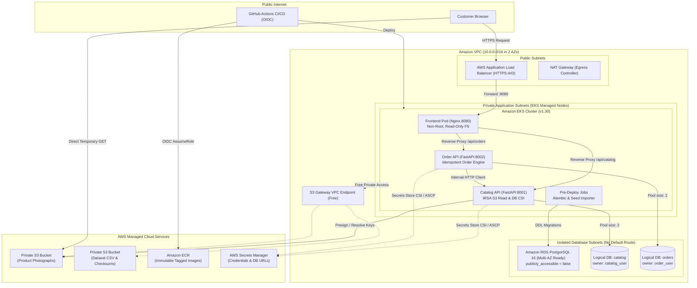

# Architecture Blueprint: EKS Beverage Store Microservices

## 1. System Overview

The **EKS Beverage Store** is a production-style, cloud-native microservices platform built on **Amazon Elastic Kubernetes Service (EKS)**, **Amazon RDS PostgreSQL**, **Amazon S3**, and **Amazon ECR**. It provides a reliable digital storefront for browsing Andhra Pradesh Govt. regulated beverage products and placing idempotent customer orders with immutable server-side price snapshots.

The system is deliberately engineered to demonstrate modern AWS DevOps and platform engineering practices:
- **Stateless Kubernetes Deployments**: Zero pod-attached persistent disks; all state lives in managed AWS cloud primitives.
- **Strict Decoupling**: Separate database schemas, distinct application identities, and bounded API communication.
- **GitOps & OIDC CI/CD**: Keyless GitHub Actions deployment via IAM OpenID Connect with immutable Git SHA tags.
- **Defense in Depth**: Non-root container contexts, dropped Linux capabilities, read-only root filesystems, Kubernetes NetworkPolicies, and isolated database subnets.

---

## 2. Target Architecture Diagram



---

## 3. Microservice Boundaries & Responsibilities

| Service | Technology | Port | Ownership | Database |
|---|---|---|---|---|
| **Frontend** | Nginx 1.27 Unprivileged | 8080 | Single-page UI, static asset delivery, reverse proxy for APIs, health routing | Stateless |
| **Catalog Service** | Python 3.11, FastAPI, SQLAlchemy 2.0 | 8001 | Beverage catalog, category/size/origin filters, text search, S3 image URL resolution | `catalog` logical DB |
| **Order Service** | Python 3.11, FastAPI, SQLAlchemy 2.0 | 8002 | Idempotent checkout, conflict detection, immutable server-side price snapshots | `orders` logical DB |
| **Catalog Seeder** | Standalone Python container | Job | Automated transactional dataset ingestion, brand/origin mapping, S3 key linkage | Migrations & seed only |

---

## 4. Beverage Origin Taxonomy: Domestic vs Foreign

Beverages are segmented across two orthogonal dimensions:
1. **Origin Group (`origin_group`)**:
   - `domestic`: Indian Made Liquor (IML), Indian Beers, and Indian Wines manufactured and distilled in India (e.g., Royal Ranthambore, Blenders Pride, Royal Stag, Old Monk, Kingfisher, Fratelli Shiraz).
   - `foreign`: Bottled In Origin (BIO) and imported finished spirits (e.g., Johnnie Walker Red Label, Jameson Irish Whisky, Ballantine's, Dewar's White Label, Absolut Vodka, Beefeater London Dry Gin, Carlsberg Elephant).
2. **Beverage Category (`category`)**:
   - `whisky`, `brandy`, `beer`, `wine`, `rum`, `vodka`, `gin`, `ready-to-drink`.

### Database Schema Constraint
```sql
ALTER TABLE catalog_items ADD COLUMN origin_group VARCHAR(32);
ALTER TABLE catalog_items ADD COLUMN country_of_origin VARCHAR(64);
ALTER TABLE catalog_items ADD CONSTRAINT chk_catalog_items_origin_group 
    CHECK (origin_group IS NULL OR origin_group IN ('domestic', 'foreign'));
CREATE INDEX ix_catalog_origin_category_size ON catalog_items (origin_group, category, size_ml);
```

---

## 5. Security & Isolation Model

### 1. Workload Identity (IAM Roles for Service Accounts - IRSA)
No AWS secret access keys are stored in containers or source control. Every pod assumes a least-privilege IAM role via Kubernetes ServiceAccount annotations and the EKS OIDC identity provider:
- **`catalog-service-sa`**: Scoped `s3:GetObject` on the asset bucket prefix and `secretsmanager:GetSecretValue` on `eks-store/lab/catalog-db`.
- **`order-service-sa`**: Read-only access to `eks-store/lab/order-db`.
- **`db-job-sa`**: Scoped access to database migration and bootstrap secrets.

### 2. Network Segmentation
- **Public Subnets**: Internet-facing ALB and NAT Gateway only.
- **Private Subnets**: EKS worker nodes and application pods. Outbound internet access via NAT; private S3 access via Gateway VPC endpoint.
- **Isolated Database Subnets**: Amazon RDS PostgreSQL has no route to the Internet (`publicly_accessible = false`). Ingress is permitted solely on port 5432 from the EKS worker nodes security group.
- **Kubernetes NetworkPolicy**: Restricts pod-to-pod communication. The frontend cannot be bypassed; orders can talk to catalog; catalog cannot query the orders database.

### 3. Container Hardening
- Containers run as unprivileged, non-root users (`101` for Nginx, `10001` for FastAPI and seed jobs).
- All Linux capabilities dropped (`drop: ["ALL"]`).
- `allowPrivilegeEscalation: false`.
- Read-only root filesystems on Nginx with `emptyDir` mounts for temporary scratch locations (`/tmp`, `/var/run`, `/var/cache/nginx`).

---

## 6. Database Lifecycle & High Availability

1. **One RDS Instance, Two Logical Databases**:
   - Reduces infrastructure cost by ~50% in lab and demo environments while enforcing logical isolation.
   - Dedicated application users (`catalog_user` and `order_user`) have zero cross-database privileges.
2. **Controlled Pre-Deploy Jobs**:
   - Database bootstrap and Alembic migrations execute as Kubernetes Jobs before the application rollout starts.
   - Replicas never run migrations on startup, eliminating race conditions during rolling updates.
3. **Connection Pool Budgeting**:
   - Tuned pool size (`DB_POOL_SIZE = 2`, `DB_MAX_OVERFLOW = 1`).
   - Worst-case connection budget across replicas and worker processes remains well below RDS PostgreSQL limits (`max_connections = 100`).
