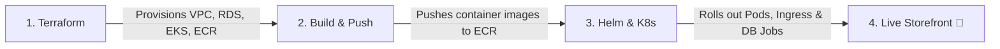

> Historical, unverified reference. Use README.md and docs/DEPLOYMENT.md for this edition.

# Simple & Complete EKS Deployment Guide

Welcome! This guide gives you a clear, step-by-step walkthrough to deploy the **EKS Beverage Store** into Amazon EKS using **Terraform**, **Docker/ECR**, **Helm**, and **GitHub Actions**.

---

## 🌟 Quick Overview: How It Works

The deployment follows a simple 3-stage flow:



You have **two ways** to deploy:
1. **Method 1 (Recommended & Easiest): 100% Automated via GitHub Actions**  
   *No need to install Docker or AWS CLI on your personal computer.* GitHub runners do all the heavy lifting!
2. **Method 2: CLI Commands**  
   *Run step-by-step commands from your local machine, EC2, or AWS CloudShell.*

---

## 🔑 Step 1: Add AWS Credentials to GitHub Secrets

To allow GitHub Actions to build, provision, and deploy automatically:

1. Open your GitHub repository in your browser: `https://github.com/<your-username>/<your-repo>`.
2. Go to **Settings** → **Secrets and variables** → **Actions**.
3. Click **New repository secret** and add the following two secrets:

| Secret Name | Value | Description |
|---|---|---|
| `AWS_ACCESS_KEY_ID` | `AKIA...` | Your AWS IAM User Access Key |
| `AWS_SECRET_ACCESS_KEY` | `wJalrX...` | Your AWS IAM User Secret Key |

*(Optional for advanced users: If using AWS IAM OIDC instead of access keys, set `AWS_GITHUB_ROLE_ARN` with your role ARN).*

---

## 🚀 Method 1: Automated Deployment via GitHub Actions (Recommended)

### Phase 1: Provision Infrastructure with Terraform (1 Click)
1. On your GitHub repository, click on the **Actions** tab.
2. In the left sidebar, click **Terraform Infrastructure Manager**.
3. Click the **Run workflow** dropdown on the right:
   - **Stack**: Choose `all` (or run in order: `network` → `data` → `platform` → `addons`).
   - **Action**: Choose `apply`.
   - **Environment**: Choose `lab` (cost-optimized).
4. Click the green **Run workflow** button!
5. GitHub will now automatically provision:
   - Your VPC across 2 Availability Zones
   - Amazon RDS PostgreSQL 16
   - Amazon S3 Assets & Artifacts buckets
   - Amazon ECR repositories (`frontend`, `catalog`, `orders`, `seed`)
   - Amazon EKS Cluster v1.32 & Worker Nodes
   - AWS Load Balancer Controller & Secrets Store CSI

---

### Phase 2: Deploy Application & Seed Database (Automated on Push)
Whenever you push code to the `main` branch, or manually trigger the deployment:

1. Go to the **Actions** tab in GitHub.
2. Click **Deploy Production EKS Store**.
3. Click **Run workflow** → select `lab` → click **Run workflow**.
4. The automated pipeline will execute:
   - **Validate**: Runs unit tests and linter.
   - **Build & Publish**: Builds all 4 container images and pushes them to Amazon ECR tagged with the short Git commit SHA.
   - **Pre-Deploy Jobs**: Runs database bootstrap and Alembic migrations inside EKS before starting pods.
   - **Deploy**: Deploys the Helm chart (`helm/eks-store`), sets up Pods, ClusterIP services, and ALB Ingress.
   - **Verify**: Runs the automated smoke test (`scripts/smoke_test.py`) against the live ALB URL!

---

## 💻 Method 2: Manual Deployment via CLI / AWS CloudShell

If you prefer to run the commands yourself, follow these steps:

### 1. Configure AWS CLI & Authenticate
```bash
aws configure
# Enter your AWS Access Key, Secret Key, and Region (e.g. eu-north-1 or us-east-1)
```

### 2. Run Terraform Stacks
Run the Terraform stacks in this exact order:
```bash
# 1. Network Stack (VPC, Subnets, Routing, SGs)
cd infra/network
terraform init
terraform apply -auto-approve

# 2. Data Stack (RDS PostgreSQL, S3 Buckets, ECR)
cd ../data
terraform init
terraform apply -auto-approve

# 3. Platform Stack (EKS Cluster & Managed Nodes)
cd ../platform
terraform init
terraform apply -auto-approve

# 4. Addons Stack (ALB Controller & Secrets CSI)
cd ../addons
terraform init
terraform apply -auto-approve
```

### 3. Connect kubectl to your new EKS Cluster
```bash
aws eks update-kubeconfig --region eu-north-1 --name eks-store-lab
kubectl get nodes
```

### 4. Build and Push Images to Amazon ECR
```bash
ACCOUNT_ID=$(aws sts get-caller-identity --query Account --output text)
REGION="eu-north-1"
REGISTRY="${ACCOUNT_ID}.dkr.ecr.${REGION}.amazonaws.com"

# Log in Docker to ECR
aws ecr get-login-password --region $REGION | docker login --username AWS --password-stdin $REGISTRY

# Build & Push Frontend
docker build -t $REGISTRY/eks-store-frontend:latest ./frontend
docker push $REGISTRY/eks-store-frontend:latest

# Build & Push Catalog Service
docker build -t $REGISTRY/eks-store-catalog:latest ./catalog-service
docker push $REGISTRY/eks-store-catalog:latest

# Build & Push Order Service
docker build -t $REGISTRY/eks-store-orders:latest ./order-service
docker push $REGISTRY/eks-store-orders:latest

# Build & Push Seed Image
docker build -f Dockerfile.seed -t $REGISTRY/eks-store-seed:latest .
docker push $REGISTRY/eks-store-seed:latest
```

### 5. Deploy with Helm
```bash
helm upgrade --install eks-store ./helm/eks-store \
  --namespace eks-store --create-namespace \
  --values ./helm/eks-store/values.yaml \
  --values ./helm/eks-store/values-lab.yaml \
  --set images.frontend.repository=$REGISTRY/eks-store-frontend \
  --set images.catalog.repository=$REGISTRY/eks-store-catalog \
  --set images.orders.repository=$REGISTRY/eks-store-orders \
  --set images.seed.repository=$REGISTRY/eks-store-seed \
  --wait --timeout 10m
```

---

## 🎯 What to Do If You Already Have an Existing EKS Cluster

If you already have your own running EKS cluster and database:
1. Open [helm/eks-store/values.yaml](file:///d:/EKS-Store-Production/helm/eks-store/values.yaml).
2. Set your image repositories or use Docker Hub / public images.
3. If using an existing database, configure your `DATABASE_URL` in the ConfigMap or Kubernetes Secret.
4. Run:
   ```bash
   helm upgrade --install eks-store ./helm/eks-store \
     --namespace eks-store --create-namespace \
     --values ./helm/eks-store/values.yaml
   ```

---

## 🌐 Step 3: Accessing & Verifying the Application

### Option A: Via Public Application Load Balancer (ALB)
Get the public DNS address assigned by AWS:
```bash
kubectl get ingress eks-store-ingress -n eks-store
```
Copy the **ADDRESS** column (e.g. `k8s-eksstore-xxxxxx.eu-north-1.elb.amazonaws.com`) and paste it into your browser.

### Option B: Via Local Port Forwarding (Instant Access)
If the ALB is still provisioning or you want instant local access:
```bash
kubectl port-forward svc/frontend 8080:80 -n eks-store
```
Open [http://localhost:8080](http://localhost:8080) in your browser!

### Run the Acceptance Smoke Test
To verify all microservices, origin filters, and order placement:
```bash
python scripts/smoke_test.py --url "http://<ALB-ADDRESS-OR-LOCALHOST:8080>"
```

You should see:
```text
[PASS] Frontend /healthz is OK
[PASS] Catalog microservice /health/live is UP
[PASS] Order microservice /health/live is UP
[PASS] Catalog returned 185 total items from database
[PASS] Domestic tab filter returned 153 items
[PASS] Foreign tab filter returned 32 items
[PASS] Order created successfully. Total: ₹2800.00
[PASS] Order item snapshot captures immutable product name and unit price
[PASS] Idempotent retry safely returned identical existing order
[PASS] Conflicting idempotency key correctly rejected with HTTP 409 Conflict
[PASS] All smoke test scenarios passed successfully!
```

---

## 💰 Step 4: Cost Control & Pausing the Environment

EKS and AWS resources cost money if left running indefinitely. We built a built-in pause workflow so you can stop billing when you take a break:

### To Pause (Saves Money):
1. Go to **Actions** → **Environment Lifecycle & Cost Control**.
2. Select `pause` → Environment: `lab` → Type `CONFIRM`.
3. Click **Run workflow**.
   - *What happens*: Scales worker nodes to 0, stops the RDS PostgreSQL instance, and deletes the ALB. **Your data is preserved!**

### To Resume:
1. Go to **Actions** → **Environment Lifecycle & Cost Control**.
2. Select `resume` → Environment: `lab` → Type `CONFIRM`.
3. Click **Run workflow**.
   - *What happens*: Restarts RDS, scales worker nodes back up to 2, and reinstalls your application with all your saved orders intact.

### To Completely Destroy (Zero Cost):
When you are finished with your demo:
1. Run the **Terraform Infrastructure Manager** workflow with action `destroy`, stack `all`, and confirmation `CONFIRM`.
2. All AWS resources will be cleaned up safely in reverse dependency order.

---

## 🔍 Troubleshooting Cheat Sheet

| Symptom | Cause | Solution |
|---|---|---|
| Pods stuck in `Pending` | No worker nodes available or insufficient CPU/memory. | Run `kubectl get nodes`. Check if the node group desired capacity is at least 1. |
| Pods in `ImagePullBackOff` | ECR repository does not exist or image tag not pushed. | Run the `build-and-publish` job in GitHub Actions or push images to ECR. |
| `CrashLoopBackOff` on Catalog / Orders | Database connection failure or unmigrated schema. | Check pod logs: `kubectl logs -n eks-store deploy/catalog-service`. Verify pre-deploy migration jobs finished successfully (`kubectl get jobs -n eks-store`). |
| Ingress has no Address | AWS Load Balancer Controller is not running in `kube-system`. | Verify controller pods: `kubectl get pods -n kube-system -l app.kubernetes.io/name=aws-load-balancer-controller`. |
| Want to test without AWS | Local development mode. | Run `docker compose up -d --build` on your computer and open [http://localhost:3000](http://localhost:3000). |
