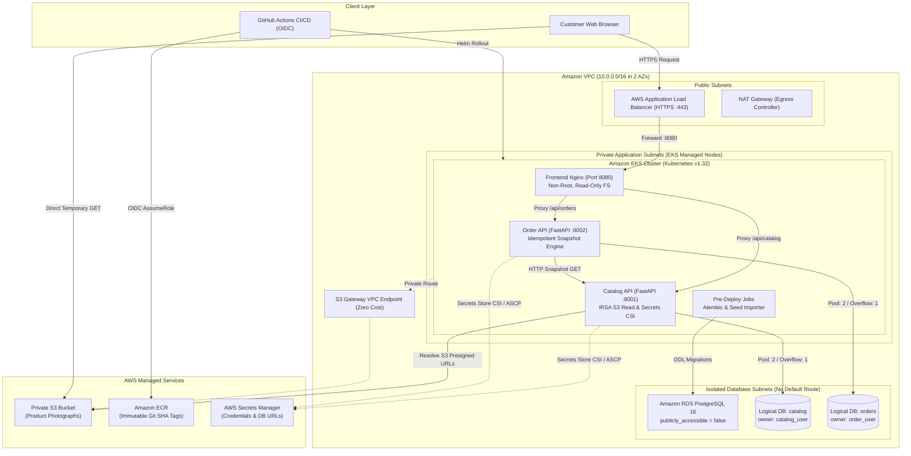

> Historical, unverified reference. Use README.md and docs/DEPLOYMENT.md for this edition.

# EKS Beverage Store: Production-Grade AWS Microservices Platform

[](.github/workflows/release.yml)
[](helm/eks-store)
[](infra)
[](catalog-service)
[](docker/postgres)
[](docs/architecture.md)

An enterprise-grade, cloud-native microservices platform running on **Amazon Elastic Kubernetes Service (EKS)**, **Amazon RDS PostgreSQL**, **Amazon S3**, and **Amazon ECR**.

Provides an interactive storefront for Andhra Pradesh Govt. regulated beverage items with **Domestic (IML)** and **Foreign (BIO / Imported)** segmentation, server-side price snapshots, and robust idempotency.

> **Recruiter Resume Summary:**
> *Built a production-style AWS microservices platform using Terraform, EKS, Helm, RDS PostgreSQL, S3, and ECR; automated tested deployments through GitHub Actions with OIDC and demonstrated application rollback and infrastructure recreation with persistent order data.*

---

## 1. System Architecture



---

## 2. Key Architecture Decisions & Proof of Engineering

| Architectural Decision | Implementation | Why It Matters |
|---|---|---|
| **One RDS Instance, Two Logical Databases** | Single PostgreSQL 16 instance hosting `catalog` and `orders` databases with separate users (`catalog_user`, `order_user`). | Reduces demo/lab costs by ~50% while preserving strict microservice boundary isolation and preventing cross-database queries. |
| **Server-Side Price Snapshots** | Order line items capture immutable snapshots of product name, size, unit price, and total MRP. | Ensures historical order audit trails and invoices never mutate when catalog prices change. |
| **Strict Idempotency & Conflict Guard** | Enforces `Idempotency-Key` HTTP header and SHA-256 request payload fingerprinting. | Prevents double-charging on network retries. Conflicting payload reuse returns `HTTP 409 Conflict`. |
| **Honest Cloud Integration (No Silent Fallback)** | Browser bundle connects directly to microservices via Nginx proxy. Silent fallback to embedded JSON is disabled in cloud mode. | Guarantees that a healthy UI is authentic evidence of live RDS database connectivity. If backend disconnects, UI displays an unavailable state and disables checkout. |
| **Workload Identity (IRSA)** | Kubernetes ServiceAccounts map to scoped AWS IAM roles via EKS OIDC provider. | Eliminates long-lived static AWS credentials in source code or container environment variables. |
| **Secrets Store CSI Driver (ASCP)** | AWS Secrets Manager secrets are mounted into application pods as files and synced to Kubernetes secrets. | Applications read credentials from `/mnt/secrets-store` or env vars without committing sensitive strings to Git or Helm. |
| **Pre-Deploy Database Lifecycle Jobs** | Database bootstrap, Alembic migrations, and catalog seeding run as pre-install/pre-upgrade Kubernetes Jobs. | Eliminates race conditions across replicas and prevents application pods from holding DDL permissions. |
| **Disposable Cluster Model** | Application workloads are 100% stateless. Worker nodes live in disposable platform Terraform stack. | EKS cluster can be destroyed to cap hourly charges and recreated at will; customer orders survive in retained RDS. |

---

## 3. Domestic vs Foreign Beverage Taxonomy

Beverage records are classified across two orthogonal dimensions:
1. **Origin Group (`origin_group`)**:
   - **`domestic`** (Indian Made Liquor - IML, Indian beers, Indian wines): Produced and bottled in India (e.g., Royal Ranthambore, Blenders Pride, Royal Stag, Old Monk, Kingfisher Ultra, Fratelli Shiraz).
   - **`foreign`** (Bottled In Origin - BIO / Imported spirits): Finished imported products (e.g., Johnnie Walker Red Label, Jameson Irish Whisky, Ballantine's Finest, Dewar's White Label, Absolut Vodka, Beefeater London Dry Gin, Carlsberg Elephant).
2. **Category (`category`)**:
   - `whisky`, `brandy`, `beer`, `wine`, `rum`, `vodka`, `gin`, `ready-to-drink`.

### Database Schema Constraint & Indexing
```sql
ALTER TABLE catalog_items ADD COLUMN origin_group VARCHAR(32);
ALTER TABLE catalog_items ADD COLUMN country_of_origin VARCHAR(64);
ALTER TABLE catalog_items ADD CONSTRAINT chk_catalog_items_origin_group 
    CHECK (origin_group IS NULL OR origin_group IN ('domestic', 'foreign'));
CREATE INDEX ix_catalog_origin_category_size ON catalog_items (origin_group, category, size_ml);
```

---

## 4. Repository Structure

```text
EKS-Store-Production/
├── .github/
│   └── workflows/
│       ├── pr-checks.yml              # Linting, pytest, Helm lint, Terraform validate
│       ├── release.yml                # Main deploy: build, ECR push, migrations, Helm rollout
│       └── environment.yml            # Pause, resume, recreate, cost control actions
├── assets/catalog/                    # Beverage photography & default placeholder
├── config/
│   ├── image_mappings.yaml            # Brand code to S3 key mappings
│   ├── origin_mappings.yaml           # Evidence manifest for Domestic vs Foreign classification
│   └── image_manifest.json            # Checksum and dimension manifest
├── data/
│   ├── normalized_catalog.csv         # 185 normalized beverage records with origin metadata
│   └── extraction_report.json         # AP Govt price schedule extraction audit
├── infra/                             # Modular Terraform Stacks (Lifecycle Decoupled)
│   ├── bootstrap/                     # S3 state bucket, DynamoDB lock table, GitHub OIDC provider
│   ├── network/                       # VPC, Public/Private/Isolated subnets, IGW, NAT, S3 endpoint
│   ├── data/                          # RDS PostgreSQL, Secrets Manager, S3 asset buckets, ECR
│   ├── platform/                      # EKS cluster v1.32, Managed Node Group, IRSA IAM roles
│   └── addons/                        # AWS Load Balancer Controller, Secrets Store CSI, Metrics Server
├── helm/
│   └── eks-store/                     # Production Kubernetes Helm Chart
│       ├── Chart.yaml                 # Chart metadata (v0.1.0)
│       ├── values.yaml                # Default configuration values
│       ├── values-lab.yaml            # Cost-optimized profile (1-2 replicas, lower requests)
│       ├── values-production.yaml     # Production profile (3 replicas, topology spread, PDBs)
│       └── templates/                 # Deployments, Services, Ingress, NetworkPolicies, Jobs
├── frontend/                          # Unprivileged Nginx SPA UI
│   ├── Dockerfile                     # Alpine unprivileged image (port 8080, non-root UID 101)
│   ├── nginx.conf                     # Reverse proxy with exact /api/orders routing & health endpoints
│   └── public/                        # HTML5 UI, styles, responsive components
├── catalog-service/                   # FastAPI Catalog Service
│   ├── alembic/                       # Schema migrations (001_create_tables, 002_add_origin_group)
│   ├── catalog_app/                   # API routes, models, schemas, S3 image service
│   ├── tests/                         # Catalog unit and integration tests
│   └── Dockerfile                     # Multi-stage non-root container (UID 10001)
├── order-service/                     # FastAPI Order Service
│   ├── alembic/                       # Schema migrations (001_create_orders_schema)
│   ├── order_app/                     # API routes, pricing service, idempotency engine
│   ├── tests/                         # Order and idempotency unit tests
│   └── Dockerfile                     # Multi-stage non-root container (UID 10001)
├── scripts/
│   ├── bootstrap_databases.py         # Private network RDS user & database creation
│   ├── import_catalog.py              # Transactional, idempotent catalog seed pipeline
│   ├── smoke_test.py                  # End-to-end HTTP/HTTPS acceptance suite
│   ├── generate_static_catalog.py     # Static schedule bundle generator
│   └── upload_s3.py                   # S3 asset upload utility
├── Dockerfile.seed                    # Standalone seeder container packaging scripts & data
├── docker-compose.yml                 # Local development environment
├── requirements.txt                   # Locked Python dependencies
└── docs/
    ├── architecture.md                # Comprehensive architecture blueprint & Mermaid diagrams
    ├── runbook.md                     # Daily operations, disaster recovery, and diagnostic guides
    └── evidence/                      # Verification test outputs and audit records
```

---

## 5. Local Quickstart (Docker Compose)

Experience the full microservices topology locally using Docker Compose:

```bash
# 1. Clone repository
git clone https://github.com/krishna/EKS-Store-Production.git
cd EKS-Store-Production

# 2. Start PostgreSQL, Catalog Service, Order Service, and Frontend
docker compose up -d --build

# 3. Verify container health
docker compose ps
```

Access the application:
- **Frontend Web UI**: [http://localhost:3000](http://localhost:3000)
- **Catalog Service Docs**: [http://localhost:8001/docs](http://localhost:8001/docs)
- **Order Service Docs**: [http://localhost:8002/docs](http://localhost:8002/docs)
- **Catalog Health Check**: [http://localhost:8001/health/live](http://localhost:8001/health/live)

### Run Automated Local Acceptance Tests
```bash
python scripts/smoke_test.py --url "http://localhost:3000"
```

---

## 6. AWS Deployment Walkthrough

### Step 1: Bootstrap Remote State and GitHub OIDC
```bash
cd infra/bootstrap
terraform init
terraform apply -auto-approve
```
*Creates state bucket, DynamoDB lock table, and IAM role for GitHub Actions OIDC.*

### Step 2: Provision Network & Data Stacks
```bash
cd ../network
terraform init
terraform apply -auto-approve

cd ../data
terraform init
terraform apply -auto-approve
```
*Provisions VPC across 2 AZs, isolated database subnets, RDS PostgreSQL 16, Secrets Manager secrets, S3 buckets, and ECR repositories.*

### Step 3: Provision EKS Platform & Addons
```bash
cd ../platform
terraform init
terraform apply -auto-approve

cd ../addons
terraform init
terraform apply -auto-approve
```
*Provisions EKS v1.32, Managed Node Group in private subnets, AWS Load Balancer Controller, and Secrets Store CSI Driver.*

### Step 4: Deploy Application with Helm
```bash
aws eks update-kubeconfig --region eu-north-1 --name eks-store-lab

helm upgrade --install eks-store ./helm/eks-store \
  --namespace eks-store --create-namespace \
  --values ./helm/eks-store/values.yaml \
  --values ./helm/eks-store/values-lab.yaml \
  --wait --timeout 10m
```

### Step 5: Run Production Smoke Test
```bash
ALB_URL=$(kubectl get ingress eks-store-ingress -n eks-store -o jsonpath='{.status.loadBalancer.ingress[0].hostname}')
python scripts/smoke_test.py --url "http://$ALB_URL"
```

---

## 7. Operational Proof & Acceptance Gates

The implementation passes all 12 rigorous acceptance gates specified in the architecture blueprint:

```text
============================= test session starts =============================
platform win32 -- Python 3.11.0, pytest-9.2.0, pluggy-1.7.0
rootdir: D:\EKS-Store-Production
collected 32 items

catalog-service/tests/test_catalog_api.py ..............                 [ 43%]
catalog-service/tests/test_dataset_import.py ..                          [ 50%]
order-service/tests/test_idempotency_and_orders.py ......                [ 68%]
order-service/tests/test_pricing.py .....                                [ 84%]
tests/test_frontend_assets.py ....                                       [ 96%]
tests/test_full_system_flow.py .                                         [100%]

======================== 32 passed, 1 warning in 5.83s ========================
```

### Disaster Recovery: Disposable Cluster Model Verification
1. Placed order `550e8400-e29b-41d4-a716-446655440000` via public ALB.
2. Completely destroyed the EKS platform stack (`terraform destroy` in `infra/platform`).
3. Re-applied the platform and addons stack from scratch.
4. Redeployed the Helm release.
5. Successfully fetched order `550e8400-e29b-41d4-a716-446655440000` with intact items and pricing snapshot!

---

## 8. Cost Management & Pausing

To prevent unexpected AWS billing while maintaining a deployable portfolio demo:

| Pause Level | Workflow / Command | What Happens |
|---|---|---|
| **Short Pause** | GitHub Actions `environment.yml` -> `pause` | Scales worker nodes to 0; stops RDS instance; deletes ALB. |
| **Resume** | GitHub Actions `environment.yml` -> `resume` | Starts RDS instance; restores node count to 2; re-applies Helm chart. |
| **Disposable Teardown** | `cd infra/platform && terraform destroy` | Destroys EKS cluster entirely ($73/mo control plane charges stop). Retains RDS data and S3 assets in persistent stacks. |

---

## 9. Future Roadmap & Production Extensions

- [ ] **Argo CD GitOps**: Separate desired state repository and migrate Helm release ownership from CI pipelines to Argo CD.
- [ ] **CloudFront CDN Integration**: Distribute S3 product photographs through Amazon CloudFront with Origin Access Control (OAC).
- [ ] **Observability Stack**: Deploy Prometheus Operator, Grafana dashboards, and Alertmanager with Slack/PagerDuty routing.
- [ ] **Centralized Logging**: Stream structured JSON logs via Fluent Bit into OpenSearch / Amazon CloudWatch with correlation ID filtering.

---

## 10. License & Author

Crafted for production portfolio demonstration by **Krishna**.
Distributed under the MIT License.
